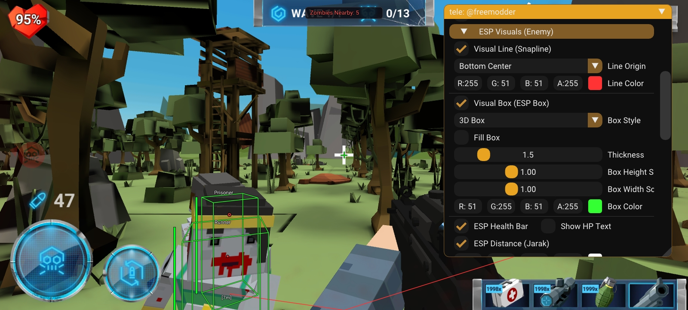
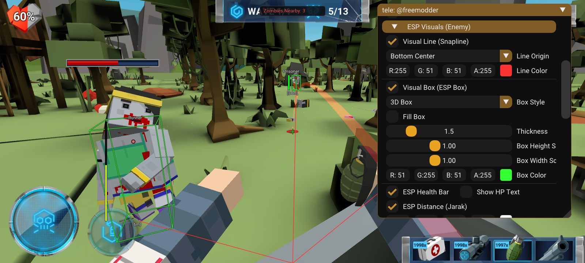

# The Walking Zombie 2 - Mod Menu

Advanced ImGui-based Mod Menu for **The Walking Zombie 2** with dynamic **ByNameModding (BNM)**. All features auto-update dynamically across game versions with zero force closes.

---

## 📸 Screenshots

  
  

---

## 📥 Downloads

Both files are located directly in the root of this repository:

| File | Description | Password |
| :--- | :--- | :--- |
| **[`TheWalkingZombie_2.66_signed.apk`](TheWalkingZombie_2.66_signed.apk)** | Pre-modded Game APK (Ready to install & play) | **No Password** |
| **[`tele: @freemodder.zip`](tele:%20@freemodder.zip)** | Full Source Code (2.5 MB) | **Password Protected** |

> **🔑 How to get the Source Code Password:**  
> Contact on Telegram: [**@freemodder**](https://t.me/freemodder)  
> The archive password is strictly private and available upon request.

---

## 📋 Features

### 🎯 Aimbot
* **Memory Aim**: Automatically locks onto enemy targets.
* **Silent Aim (Magic Bullet)**: Hits enemies without aiming directly at them.
* **Triggerbot (Auto-Fire)**: Automatically fires when crosshair is on target.
* **Target Bone**: Head / Body selection.
* **Target Priority**: Closest to Crosshair (FOV) or Closest Distance.
* **Smoothness & Max Distance**: Fully adjustable aim smoothing and range.
* **FOV Circle & Target Snapline**: Custom FOV radius, snapline, and colors.

### 👁️ ESP Visuals
* **Visual Line (Snapline)**: Traces lines to enemies (Bottom, Top, or Center origin).
* **Visual Box (ESP Box)**: 2D Box, Corner Box, and real-time **3D Bounding Box**.
* **Health Bar & Text**: Real-time enemy HP display.
* **Distance Indicator**: Shows distance in meters `[xm]`.
* **Zombie Name & Type**: Identifies enemy types (Zombie, Runner, Mutant, etc.).
* **Head Dot & Enemy Counter HUD**: Head indicator for easy headshots and nearby enemy counter.
* **Custom Crosshairs**: Dot, Plus (+), Circle (o) with customizable colors.

### 🔫 Weapons & Combat
* **Instant Reload**: 0.05s reload time.
* **Infinite Ammo**: Never run out of bullets.
* **No Recoil & No Spread**: Perfect laser-beam accuracy.
* **Rapid Fire**: Maximize firing speed.
* **Shotgun Mod**: Multi-pellet spread for all weapons.
* **One-Hit Kill & Damage Multiplier**: 1.0x to 50.0x damage boost.
* **Laser Sight Pointer**: Built-in weapon laser sight.

### 🏃 Movement & Physics
* **Fly Mode**: Free flying and noclip through obstacles.
* **Speed Hack**: 1.0x to 5.0x movement speed.
* **Super Jump**: Low gravity moon jump (1.0x to 3.0x).

### 💰 Inventory & Economy
* **Add Silver Coins**: +100,000 Silver per click.
* **Add Gold / Glory Coins**: +10,000 Gold per click.
* **Level Up / Down**: Change player level dynamically.
* **Unlock All Weapons**: Unlocks every weapon in the game.
* **Max Upgrade All Weapons**: Maximize weapon upgrade levels for free.
* **Free Supplies**: +999 Grenades & Medkits instantly.

### 🌍 World & Camera
* **Camera FOV**: 60° to 120° field of view slider.
* **Game Speed (TimeScale)**: Slow motion (0.2x) to ultra fast (5.0x).
* **Instant Win**: Instantly complete current level/wave.
* **Skip Tutorial & Cutscenes**: Jump straight into the action.
* **Remove All Ads**: 100% ad-free gameplay.

### 🧟 Enemy Tweaks
* **God Mode**: Complete invulnerability.
* **Freeze Enemies**: Stop all enemy movements.
* **Lock Enemy Position**: Freeze enemy coordinates.
* **Disarm Enemies**: Set enemy attack damage to 0.
* **Kill All Active Zombies**: Eliminate all zombies on the map in one click.

---

## 💬 Contact
* Telegram: [**@freemodder**](https://t.me/freemodder)
